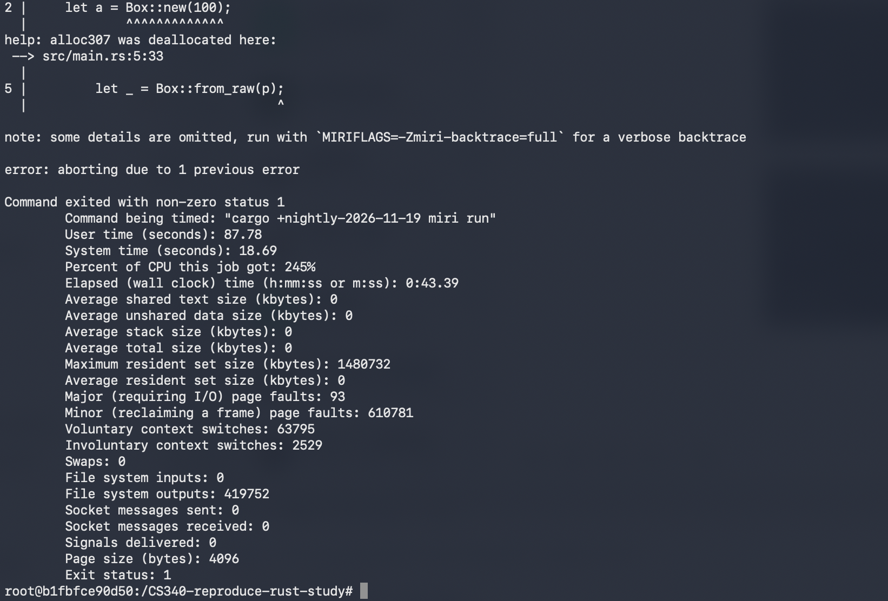

# UAF Test Case (Use-After-Free)
Student ID: 1240034584

## Source Code (`src/main.rs`)
```rust
fn main() {
    let a = Box::new(100);
    let p = Box::into_raw(a);
    unsafe {
        let _ = Box::from_raw(p);
        *p = 200;
        println!("{}", *p);
    }
}

```
## Miri Detection Result

```
error: Undefined Behavior: memory access failed: alloc288 has been freed, so this pointer is dangling
 --> src/main.rs:6:9
  |
6 |         *p = 200;
  |         ^^^^^^^^ Undefined Behavior occurred here
  |
  = help: this indicates a bug in the program: it performed an invalid operation, and caused Undefined Behavior
  = help: see https://doc.rust-lang.org/nightly/reference/behavior-considered-undefined.html for further information
help: alloc288 was allocated here:
 --> src/main.rs:2:13
  |
2 |     let a = Box::new(100);
  |             ^^^^^^^^^^^^^
help: alloc288 was deallocated here:
 --> src/main.rs:5:33
  |
5 |         let _ = Box::from_raw(p);
  |                                 ^

note: some details are omitted, run with `MIRIFLAGS=-Zmiri-backtrace=full` for a verbose backtrace

error: aborting due to 1 previous error
```
## Bug Description
This program has a use-after-free bug.
It allocates memory on the heap, then releases it.
The program still tries to write data to the freed memory, which is undefined behavior.
Miri can detect this dangling pointer access.
# UAF Test Case
- Bug Type: Use-After-Free
- File: uaf_demo.rs
- Description: This unsafe Rust snippet constructs a use-after-free vulnerability.
- Testing Command (for Section 7 detector):
```bash
./target/debug/uaf-detector uaf_demo.rs
```
- Expected Output:
```
Warning: found use-after-free bug at line 9, inside unsafe block
```
- Note: The uaf-detector static analyzer will be implemented in Section 7. It is not available in the repository for now.
